# 🚕 Uber Real-Time Data Engineering Project

<div align="center">

### Une architecture moderne de Data Engineering en temps réel, inspirée de l'écosystème Uber

**Générez des courses réalistes, diffusez-les avec Azure Event Hubs et traitez-les en continu avec PySpark.**

<br>


<br>

[Présentation](#-présentation) •
[Architecture](#-architecture-du-projet) •
[Installation](#-installation) •
[Configuration](#-configuration-azure-et-variables-denvironnement) •
[Exécution](#-lancer-le-projet) •
[Améliorations](#-améliorations-et-évolutions-possibles)

</div>

---

## 📖 Présentation

**Uber Real-Time Data Engineering Project** est un projet éducatif complet qui reproduit le fonctionnement simplifié d'une plateforme de réservation de trajets en temps réel.

Lorsqu'un utilisateur clique sur **Book Ride**, l'application FastAPI génère une course Uber fictive, mais réaliste. Cette course contient des informations sur le passager, le chauffeur, le véhicule, le trajet, les coordonnées GPS, le prix et le statut final. L'événement est ensuite converti au format JSON, publié dans **Azure Event Hubs**, puis consommé et traité en continu par **PySpark Structured Streaming** à travers l'interface compatible Kafka d'Azure Event Hubs.

Le projet permet de comprendre comment plusieurs briques d'une architecture data moderne peuvent être intégrées dans un même pipeline :

- une application web qui déclenche la génération des événements ;
- un générateur de données synthétiques réalistes ;
- un producteur d'événements cloud ;
- une plateforme de streaming distribuée ;
- un moteur de traitement de données en temps réel ;
- une base extensible vers un Data Lake, un Lakehouse ou un tableau de bord analytique.

> [!NOTE]
> Toutes les données générées dans ce projet sont fictives. Elles sont destinées à l'apprentissage, à la démonstration et à l'expérimentation.

---

## 🎯 Objectifs pédagogiques

Ce projet a été conçu pour :

- comprendre une architecture événementielle de bout en bout ;
- découvrir le rôle d'un **producer**, d'un **broker** et d'un **consumer** ;
- apprendre à publier des événements dans **Azure Event Hubs** ;
- exploiter l'interface Kafka d'Event Hubs avec une connexion sécurisée ;
- traiter un flux continu avec **PySpark Structured Streaming** ;
- manipuler des données JSON dans un contexte distribué ;
- connecter une API web à un pipeline de Data Engineering ;
- construire un projet démonstratif pour un portfolio Data Engineer ;
- préparer une base pour des cas d'usage analytiques, BI ou Machine Learning.

---

## 🏗️ Architecture du projet

<div align="center">

### Vue globale de l'architecture


<sub>Le fichier source de l'architecture est disponible au format PNG dans <code>architecture.png</code> et au format vectoriel dans <code>Uber_Project.svg</code>.</sub>

</div>

> [!TIP]
> Pour que l'image apparaisse correctement sur GitHub, placez impérativement le fichier `architecture.png` à la racine du dépôt, au même niveau que `README.md`.

### Lecture simplifiée du flux

```mermaid
flowchart LR
    U[👤 Utilisateur] -->|Clique sur Book Ride| API[⚡ API FastAPI]
    API --> GEN[🎲 Générateur Faker]
    GEN --> JSON[📦 Événement JSON]
    JSON --> PROD[📤 EventHubProducerClient]
    PROD --> EH[☁️ Azure Event Hubs]
    EH -->|Endpoint Kafka SASL SSL| SPARK[🔥 PySpark Streaming]
    SPARK --> TRANS[⚙️ Décodage et transformations]
    TRANS --> OUT[📊 Analytics, Data Lake ou Dashboard]
```



### Flux détaillé, étape par étape

```text
┌──────────────────────────┐
│  1. Utilisateur          │
│  Clique sur Book Ride    │
└────────────┬─────────────┘
             │ Requête HTTP
             ▼
┌──────────────────────────┐
│  2. FastAPI              │
│  Reçoit la réservation   │
└────────────┬─────────────┘
             │ Appel de data.py
             ▼
┌──────────────────────────┐
│  3. Faker + logique      │
│  Génèrent une course     │
└────────────┬─────────────┘
             │ Sérialisation JSON
             ▼
┌──────────────────────────┐
│  4. Producteur Azure     │
│  Crée un batch           │
└────────────┬─────────────┘
             │ Publication
             ▼
┌──────────────────────────┐
│  5. Azure Event Hubs     │
│  Centralise le flux      │
└────────────┬─────────────┘
             │ Protocole Kafka sécurisé
             ▼
┌──────────────────────────┐
│  6. PySpark Streaming    │
│  Lit et décode le flux   │
└────────────┬─────────────┘
             │ Transformations
             ▼
┌──────────────────────────┐
│  7. Exploitation         │
│  Analyse et stockage     │
└──────────────────────────┘
```

---

## 🧩 Composants techniques

### 1. Couche Web et API avec `api.py`

La couche de présentation constitue le point d'entrée du projet. Elle fournit une interface web simple permettant de simuler une réservation de trajet.

#### Responsabilités

- démarrer l'application FastAPI ;
- afficher la page d'accueil ;
- recevoir l'action de réservation ;
- appeler le générateur de données ;
- déclencher l'envoi de l'événement ;
- afficher une page de confirmation.

#### Routes principales

| Méthode | Route | Rôle |
|---|---|---|
| `GET` | `/` | Affiche la page d'accueil |
| `POST` | `/book` | Génère et publie une nouvelle course |

L'application utilise **Jinja2** pour rendre les templates HTML et s'exécute sur le port `8000`.

### 2. Couche de génération avec `data.py`

Le fichier `data.py` construit des événements synthétiques cohérents. La bibliothèque **Faker** produit les informations fictives tandis que la logique métier enrichit chaque course avec des attributs propres au domaine du transport.

#### Catégories de données générées

- **Identifiants** : `ride_id`, `passenger_id`, `driver_id`, `vehicle_id` ;
- **Passager** : nom, adresse e-mail, téléphone et autres attributs fictifs ;
- **Chauffeur** : identité, téléphone, note et informations associées ;
- **Véhicule** : marque, modèle éventuel, couleur et plaque d'immatriculation ;
- **Trajet** : point de départ, destination, distance et durée ;
- **Géolocalisation** : latitude et longitude de départ et d'arrivée ;
- **Tarification** : prix de base, charges liées à la distance et au temps, pourboire et multiplicateur de surcharge ;
- **État métier** : course terminée ou annulée ;
- **Contexte géographique** : choix parmi 10 villes américaines préconfigurées.

Chaque appel produit un événement unique afin de simuler un flux continu et varié.

### 3. Couche d'ingestion avec `connection.py`

Cette couche joue le rôle de **producteur d'événements**. Elle reçoit l'objet Python généré, le sérialise et le publie dans Azure Event Hubs.

#### Fonctionnement

1. chargement de la chaîne de connexion depuis les variables d'environnement ;
2. initialisation de `EventHubProducerClient` ;
3. conversion de la course au format JSON ;
4. création d'un batch d'événements ;
5. ajout de l'événement dans le batch ;
6. envoi du batch vers l'Event Hub ;
7. gestion des erreurs de connexion ou de publication ;
8. fermeture propre du client.

### 4. Couche de streaming avec `Code_Files/ingest.py`

Le fichier `ingest.py` représente le consommateur distribué du pipeline. Il utilise **PySpark Structured Streaming** et se connecte au point d'accès Kafka fourni par Azure Event Hubs.

#### Configuration principale

- serveur Kafka : `{EH_NAMESPACE}.servicebus.windows.net:9093` ;
- protocole de sécurité : `SASL_SSL` ;
- authentification par chaîne de connexion Azure ;
- lecture à partir de l'offset `earliest` ;
- limite de `10 000` messages par déclenchement ;
- conversion des valeurs Kafka de type binaire vers des chaînes de caractères ;
- exécution continue du traitement en mode streaming.

#### Transformations envisageables

- interprétation du JSON avec un schéma Spark explicite ;
- sélection et renommage des colonnes ;
- filtrage des événements invalides ;
- calcul du prix moyen par ville ;
- comparaison des courses terminées et annulées ;
- agrégations temporelles par fenêtres ;
- détection des zones à forte demande ;
- stockage dans Azure Data Lake Storage ou Delta Lake.

---

## 🛠️ Stack technologique

| Couche | Technologies | Utilité |
|---|---|---|
| Interface web | HTML, Jinja2 | Affichage et interaction utilisateur |
| Backend | Python, FastAPI, Uvicorn | API et orchestration de la réservation |
| Données synthétiques | Faker | Génération d'informations fictives réalistes |
| Sérialisation | JSON | Format d'échange des événements |
| Ingestion cloud | Azure Event Hubs | Réception et diffusion du flux d'événements |
| Compatibilité streaming | Apache Kafka | Interface de consommation distribuée |
| Traitement | Apache Spark, PySpark | Traitement continu et transformations |
| Configuration | python-dotenv | Chargement des variables d'environnement |
| Gestion des paquets | pip, `requirements.txt` | Installation reproductible des dépendances |
| Cloud | Microsoft Azure | Hébergement du service de messagerie |

---

## 📁 Structure du projet

```text
Uber_Data_Engineer_Project/
│
├── api.py                       # Application FastAPI et routes web
├── data.py                      # Générateur de courses synthétiques
├── connection.py                # Producteur Azure Event Hubs
│
├── Code_Files/
│   └── ingest.py                # Consommateur PySpark Streaming
│
├── templates/
│   ├── home.html                # Page d'accueil
│   └── confirmation.html        # Confirmation de la réservation
│
├── architecture.png             # Image principale de l'architecture
├── Uber_Project.svg             # Version vectorielle de l'architecture
├── requirements.txt             # Dépendances Python
├── .env                         # Secrets locaux, à ne jamais versionner
└── README.md                    # Documentation du projet
```

---

## ✅ Prérequis

Avant de commencer, vérifiez la disponibilité des éléments suivants :

- **Python 3.x** ;
- **pip** pour installer les dépendances ;
- **Git** pour cloner le dépôt ;
- **Java** correctement installé pour Apache Spark ;
- **Apache Spark** ou un environnement compatible PySpark ;
- un abonnement **Microsoft Azure** ;
- un namespace **Azure Event Hubs** ;
- un Event Hub, par exemple `ubertopic` ;
- une politique d'accès partagé autorisée à envoyer et écouter les événements ;
- une chaîne de connexion Azure Event Hubs valide.

Vérification rapide des outils :

```bash
python --version
pip --version
java -version
spark-submit --version
```

---

## 🚀 Installation

### 1. Cloner le dépôt

```bash
git clone <URL_DE_VOTRE_DEPOT>
cd Uber_Data_Engineer_Project
```

### 2. Créer un environnement virtuel

```bash
python -m venv .venv
```

#### Linux ou macOS

```bash
source .venv/bin/activate
```

#### Windows PowerShell

```powershell
.venv\Scripts\Activate.ps1
```

#### Windows CMD

```cmd
.venv\Scripts\activate.bat
```

### 3. Installer les dépendances

```bash
pip install --upgrade pip
pip install -r requirements.txt
```

Le fichier `requirements.txt` doit notamment contenir :

```text
fastapi
uvicorn
faker
azure-eventhub
pyspark
python-dotenv
jinja2
```

---

## ☁️ Configuration Azure

### 1. Créer un namespace Event Hubs

Depuis le portail Azure :

1. recherchez **Event Hubs** ;
2. créez un namespace ;
3. choisissez un groupe de ressources et une région ;
4. attendez la fin du déploiement.

### 2. Créer l'Event Hub

Dans le namespace nouvellement créé :

1. ouvrez **Event Hubs** ;
2. sélectionnez **Create** ;
3. utilisez par exemple le nom `ubertopic` ;
4. choisissez le nombre de partitions adapté à votre expérimentation ;
5. validez la création.

### 3. Configurer l'accès partagé

Créez ou sélectionnez une politique SAS possédant les droits nécessaires :

- **Send** pour le producteur FastAPI ;
- **Listen** pour le consommateur Spark ;
- évitez le droit **Manage** si celui-ci n'est pas nécessaire.

> [!CAUTION]
> Le principe du moindre privilège doit être appliqué. En production, séparez idéalement les identifiants du producteur et du consommateur.

---

## 🔐 Configuration Azure et variables d'environnement

Créez un fichier `.env` à la racine du projet :

```env
CONNECTION_STRING=your_azure_eventhub_connection_string
EVENT_HUBNAME=ubertopic
```

Selon l'implémentation exacte de `ingest.py`, vous pouvez également avoir besoin du namespace :

```env
EH_NAMESPACE=your_event_hubs_namespace
```

### Exemple de structure de la chaîne de connexion

```text
Endpoint=sb://<namespace>.servicebus.windows.net/;SharedAccessKeyName=<policy>;SharedAccessKey=<secret>;EntityPath=<event-hub>
```

> [!WARNING]
> Ne publiez jamais une vraie chaîne de connexion dans GitHub, une capture d'écran, un notebook, un fichier de logs ou le README.

Ajoutez au minimum ceci dans `.gitignore` :

```gitignore
# Secrets et configuration locale
.env
.env.*

# Environnement Python
.venv/
venv/

# Cache Python
__pycache__/
*.py[cod]

# Spark
.checkpoint/
spark-warehouse/

# Outils et système
.vscode/
.idea/
.DS_Store
```

---

## ▶️ Lancer le projet

### Étape 1 : démarrer l'API FastAPI

Depuis la racine du projet :

```bash
uvicorn api:app --host 0.0.0.0 --port 8000 --reload
```

Une fois le serveur lancé, ouvrez :

```text
http://localhost:8000
```

Le mode `--reload` est pratique pendant le développement. Il ne doit pas être utilisé tel quel dans un déploiement de production.

### Étape 2 : réserver une course fictive

1. ouvrez la page d'accueil ;
2. cliquez sur **Book Ride** ;
3. FastAPI appelle le générateur de données ;
4. une nouvelle course est créée ;
5. l'événement est envoyé à Azure Event Hubs ;
6. la page de confirmation est affichée.

### Étape 3 : démarrer le consommateur Spark

Dans un second terminal :

```bash
spark-submit Code_Files/ingest.py
```

Le job Spark démarre une requête de streaming, lit les événements depuis Azure Event Hubs et affiche ou transforme les données selon la logique du script.

### Étape 4 : tester le flux de bout en bout

Pour valider l'architecture :

1. laissez le job Spark actif ;
2. générez plusieurs réservations depuis l'interface ;
3. observez les événements apparaître côté Spark ;
4. vérifiez qu'aucune erreur d'authentification n'est retournée ;
5. contrôlez que le JSON reçu correspond aux événements générés.

---

## 🧾 Exemple d'événement JSON

L'exemple suivant illustre la forme possible d'un événement. Les noms exacts des champs doivent correspondre à l'implémentation de `data.py`.

```json
{
  "ride_id": "3d9a6e01-6a24-4d59-9a4f-d1ac7257c931",
  "passenger_id": "a9b1953d-5658-4f18-b62a-8881ce981e12",
  "driver_id": "f787ce63-b84e-4f11-b85c-d12354f49ce0",
  "vehicle_id": "8bf82c92-7864-46e2-b0cc-e859b33f2991",
  "passenger_name": "Alex Johnson",
  "driver_name": "Taylor Smith",
  "driver_rating": 4.8,
  "vehicle_brand": "Toyota",
  "vehicle_color": "Black",
  "pickup_location": {
    "latitude": 40.7128,
    "longitude": -74.0060
  },
  "dropoff_location": {
    "latitude": 40.7580,
    "longitude": -73.9855
  },
  "distance": 6.8,
  "duration_minutes": 21,
  "surge_multiplier": 1.2,
  "tip": 4.0,
  "status": "completed"
}
```

> [!IMPORTANT]
> Cet objet est fourni à titre d'illustration. Le fichier `data.py` reste la source de vérité concernant le schéma réel.

---

## 💰 Logique de tarification

Le prix total d'une course peut être représenté conceptuellement par la formule suivante :

```text
Prix total = (prix de base + coût distance + coût durée) × multiplicateur de surcharge + pourboire
```

Cette logique permet de simuler :

- une tarification standard ;
- l'effet de la distance ;
- l'effet de la durée ;
- les périodes de forte demande ;
- l'ajout d'un pourboire ;
- la diversité des montants dans le flux.

---

## 🔒 Sécurité et bonnes pratiques

### Secrets

- ne stockez aucun secret directement dans le code ;
- chargez les identifiants depuis `.env` en local ;
- ajoutez `.env` dans `.gitignore` ;
- faites immédiatement tourner une clé exposée ;
- utilisez Azure Key Vault pour un environnement sérieux ;
- étudiez les identités managées lorsque l'architecture le permet.

### Validation des données

- définissez un modèle Pydantic pour valider les événements ;
- vérifiez les types, les champs obligatoires et les valeurs acceptées ;
- conservez une version du schéma ;
- isolez les événements invalides dans un flux d'erreurs.

### Résilience

- implémentez des tentatives avec délai progressif ;
- configurez les checkpoints Spark ;
- journalisez les erreurs sans afficher les secrets ;
- surveillez la latence, le débit et les échecs ;
- ajoutez une stratégie de reprise après incident.

---

## 📊 Analyses possibles

Une fois les événements décodés, le pipeline peut alimenter plusieurs indicateurs :

- nombre de courses par ville ;
- chiffre d'affaires estimé par période ;
- prix moyen par kilomètre ;
- durée moyenne des trajets ;
- taux d'annulation ;
- note moyenne des chauffeurs ;
- zones de départ les plus actives ;
- heures de pointe ;
- effet du multiplicateur de surcharge ;
- montant moyen des pourboires ;
- nombre d'événements traités par minute ;
- retard entre la production et la consommation.

---

## 🧪 Scénarios de test

### Test fonctionnel

- ouvrir `/` et vérifier l'affichage de la page ;
- envoyer une réservation via `/book` ;
- vérifier que la page de confirmation est rendue ;
- contrôler la création d'un nouvel événement.

### Test d'intégration

- lancer l'API et Spark simultanément ;
- générer plusieurs événements ;
- vérifier leur arrivée dans Event Hubs ;
- comparer les données produites et consommées.

### Test de robustesse

- tester avec une chaîne de connexion invalide ;
- simuler une indisponibilité réseau ;
- générer rapidement plusieurs réservations ;
- soumettre un événement incomplet ;
- redémarrer le job Spark et vérifier la reprise.

---

## 🌟 Points forts du projet

- **End-to-end** : de l'interface utilisateur jusqu'au moteur de traitement distribué ;
- **Temps réel** : publication et consommation continues des événements ;
- **Cloud-native** : intégration avec Azure Event Hubs ;
- **Réaliste** : données enrichies grâce à Faker et aux règles métier ;
- **Modulaire** : séparation claire entre génération, API, ingestion et traitement ;
- **Sécurisé** : communication Kafka avec SASL/SSL ;
- **Évolutif** : ajout possible d'un Data Lake, d'un Lakehouse ou d'une BI ;
- **Portfolio-ready** : architecture visuelle, documentation complète et technologies recherchées.

---

## 🚧 Améliorations et évolutions possibles

### Niveau 1 : qualité du code

- ajouter des modèles Pydantic ;
- centraliser la configuration ;
- adopter des logs structurés ;
- ajouter des tests unitaires avec `pytest` ;
- documenter précisément le schéma des événements ;
- ajouter le formatage et le linting automatiques.

### Niveau 2 : fiabilité du streaming

- définir un schéma Spark explicite ;
- utiliser `from_json` pour parser les événements ;
- activer les checkpoints ;
- gérer les données tardives avec des watermarks ;
- ajouter une stratégie de mise en quarantaine ;
- surveiller le débit et la latence du pipeline.

### Niveau 3 : plateforme analytique

- écrire les données brutes dans Azure Data Lake Storage ;
- organiser les données en couches Bronze, Silver et Gold ;
- adopter Delta Lake pour les transactions et l'historisation ;
- construire des agrégations métiers ;
- connecter Power BI aux tables finales.

### Niveau 4 : industrialisation

- conteneuriser FastAPI avec Docker ;
- déployer l'API dans Azure Container Apps ou App Service ;
- exécuter Spark dans Azure Databricks ou une plateforme Spark managée ;
- déployer l'infrastructure avec Terraform ou Bicep ;
- mettre en place une CI/CD avec GitHub Actions ;
- gérer les secrets avec Azure Key Vault ;
- ajouter la supervision avec Azure Monitor.

---

## 🎓 Cas d'usage

| Cas d'usage | Valeur apportée |
|---|---|
| Apprentissage | Comprendre les architectures de streaming modernes |
| Portfolio | Présenter un projet Data Engineering concret et complet |
| Prototype | Tester rapidement une architecture événementielle |
| Démonstration | Expliquer Event Hubs, Kafka et Spark lors d'un entretien |
| Expérimentation | Essayer des transformations et agrégations temps réel |
| Analytics | Préparer des indicateurs autour de courses fictives |

---

## 🩺 Dépannage

### L'API ne démarre pas

- vérifiez que l'environnement virtuel est activé ;
- installez les dépendances manquantes ;
- confirmez que l'objet FastAPI dans `api.py` s'appelle bien `app` ;
- vérifiez que le port `8000` est disponible.

### Aucun événement n'arrive dans Event Hubs

- contrôlez `CONNECTION_STRING` et `EVENT_HUBNAME` ;
- vérifiez le droit `Send` de la politique SAS ;
- assurez-vous que le nom de l'Event Hub est correct ;
- consultez les logs du producteur.

### Spark ne se connecte pas

- vérifiez le namespace et le port `9093` ;
- contrôlez la configuration `SASL_SSL` ;
- vérifiez le droit `Listen` ;
- confirmez que les dépendances Kafka nécessaires à Spark sont disponibles ;
- vérifiez la compatibilité entre les versions de Spark, Scala et du connecteur.

### L'image d'architecture ne s'affiche pas

- vérifiez que `architecture.png` existe à la racine ;
- respectez exactement les majuscules et minuscules du nom ;
- utilisez un chemin relatif : `./architecture.png` ;
- ajoutez et poussez bien l'image dans le dépôt Git.

---

## 📺 Ressources du projet

- [🎬 Regarder le projet complet sur YouTube](https://youtu.be/5KIbhHo6GJA?si=ktBADBZbM3IqRJ2s)
- [🖼️ Ouvrir l'architecture au format PNG](./architecture.png)
- [📐 Ouvrir l'architecture au format SVG](./Uber_Project.svg)

---

## 🤝 Contribution

Les contributions sont les bienvenues.

1. créez un fork du dépôt ;
2. créez une branche dédiée ;
3. développez et testez votre amélioration ;
4. rédigez un message de commit clair ;
5. poussez votre branche ;
6. ouvrez une Pull Request avec une description complète.

```bash
git checkout -b feature/nom-de-la-fonctionnalite
git add .
git commit -m "feat: ajouter une nouvelle fonctionnalité"
git push origin feature/nom-de-la-fonctionnalite
```

---

## 📄 Licence

Ajoutez une licence adaptée à votre projet, par exemple la licence MIT, puis placez-la dans un fichier `LICENSE` à la racine du dépôt.

---

## 👤 Auteur

<div align="center">

### **Amine Ait Ali**

Étudiant et passionné par le Data Engineering, le Cloud et les architectures des données .

<br>

**Si ce projet vous a été utile, pensez à lui attribuer une ⭐ sur GitHub.**

<br>

*Construire des pipelines, transformer des événements et donner de la valeur aux données.*

</div>
